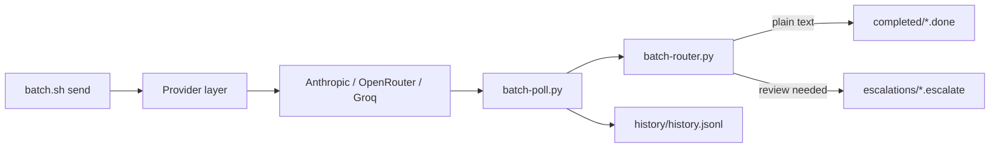

# Batch Processing Helper

Async batch processing for LLM work. Submit prompts to **Anthropic, OpenRouter, or Groq**, poll for completion, route results for review, and track latency, tokens, and cost.

The project provides four interfaces over the same provider layer:

- **CLI** — submit and monitor batches from scripts or a terminal.
- **Web console** — configure providers and operate the pipeline from a local browser dashboard.
- **MCP server** — expose pipeline operations to Pi, Claude Desktop, and other MCP hosts.
- **HTTP chat gateway** — turn OpenAI-compatible chat requests into provider batches.

**Contents:** [Features](#features) · [Supported providers](#supported-providers) · [Quick start](#quick-start) · [Web console](#web-console) · [Commands](#commands) · [How it works](#how-it-works) · [Batch management](#batch-management) · [MCP server](#mcp-server) · [Chat gateway](#chat-gateway) · [Configuration](#configuration) · [API key sources](#api-key-sources) · [Results and metrics](#results-and-metrics) · [Development](#development) · [Limitations](#limitations) · [Industrial readiness](#industrial-readiness)

## Features

- Three supported provider integrations: Anthropic, OpenRouter, and Groq
- Multi-request batches with one provider request per prompt
- Background polling through `batch-orchestrator.sh` and cron
- LLM classification into archived text and human-review escalations
- Persistent history with provider/model latency, token, and cost metrics
- Interactive Textual TUI
- Local authenticated web console for setup, monitoring, submission, and control
- Provider-aware batch management: filtering, detail inspection, polling, cancellation, dismissal, and JSON export
- MCP tools for status, submission, polling, history, and escalations
- OpenAI-compatible HTTP gateway for Groq and OpenRouter
- Owner-only private credential setup
- Claude Code, Claude Desktop, and generic agent skills
- Offline regression suite with optional live tests

## Supported providers

| Provider | Credential | Default model | Batch cancellation | Verification |
|---|---|---|---|---|
| **Anthropic** | `ANTHROPIC_API_KEY` | `claude-haiku-4-5-20251001` | Supported | Offline integration tests |
| **OpenRouter** | `OPENROUTER_API_KEY` | `deepseek/deepseek-v4.1-flash` | Not supported | Smoke-tested and offline-tested |
| **Groq** | `GROQ_API_KEY` | `openai/gpt-oss-20b` | Supported | Live-tested and offline-tested |

Provider availability and supported batch models can change. Check the provider's current documentation before submitting paid work.

## Quick start

Requirements: Linux or macOS, Python 3.9 or newer, and an API key for one provider.

```bash
git clone https://github.com/Hello-My-Name-Is-Kay/Batch-Processing-Helper.git
cd Batch-Processing-Helper
python3 -m venv venv
source venv/bin/activate
pip install -r requirements.txt
```

Configure a key in the exported environment, a system/global environment file, the owner-only private credential store, or the git-ignored `.env` file. The quickest local option is:

```bash
cp .env.example .env
chmod 600 .env
```

```dotenv
BATCH_PROVIDER=groq
GROQ_API_KEY=gsk_...
```

Start the services (gateway for Pi, plus the web page):

```bash
fish start-server.fish --console     # or: ./start-server.sh --console
```

Then open **http://127.0.0.1:8788/** and paste the token, or use the login URL printed at startup.

See [API key sources](#api-key-sources) for the complete lookup order and system-wide options.

Submit a batch and inspect its state:

```bash
bash batch.sh send "Summarize batch APIs in three bullets"
bash batch.sh status
bash batch.sh poll
```

Use `--dry-run` before the first paid submission:

```bash
bash batch.sh --provider groq --dry-run send "Summarize batch APIs in three bullets"
```

## Web console

The web console is the browser page for setup, monitoring, and control. It is a separate service from the OpenAI-compatible gateway.

| What | Port | Started by |
|---|---|---|
| Web console (browser page) | `8788` | `start-server --console`, or `start-console` |
| Gateway (Pi, OpenAI-compatible API) | `8787` | `start-server` (with or without `--console`) |

Start both in the background:

```bash
fish start-server.fish --console        # gateway + web page
fish start-server.fish --status         # what is running
fish start-console.fish stop            # stop only the web page
```

The same actions exist in Bash: `./start-server.sh --console`, `./start-console.sh start|stop|status`.

Open **http://127.0.0.1:8788/**. The page asks for the console token. The login URL with the token is printed when the console starts and written to `~/.local/state/batch-console/console.log` (owner-only). The token itself is stored in `~/.config/batch-processing-helper/console-token`.

To run the page in the foreground instead (Ctrl+C to stop):

```bash
./start-console.sh            # or: venv/bin/python batch_console.py serve --open
```

The console binds to `127.0.0.1:8788` by default. The login URL contains the console access token in its fragment. Keep that URL private; the fragment is used by the browser as a session token and is never sent in the URL request.

The console includes:

- Provider credential setup for Anthropic, OpenRouter, and Groq
- Credential connection tests and live model discovery
- Pipeline overview, active batches, history, metrics, and logs
- Batch management with search, provider/status filters, details, single-batch polling, provider-aware cancellation, local dismissal, and JSON download
- Escalation review and result-file inventory
- Batch submission with dry-run and explicit paid-operation confirmation
- One-click poll/router cycles
- Gateway health, start, stop, and restart controls

Provider keys entered in the console are written to the owner-only private credential store. They are never returned by an API response or stored in browser local storage. The console is loopback-only and every API request requires the per-user console token.

The Setup page also displays the active source of each provider credential and the available user/system environment files, without displaying any key value.

## Commands

| Command | Purpose |
|---|---|
| `bash batch.sh send "task" ["task" ...]` | Submit one or more prompts as one batch |
| `bash batch.sh send-file FILE` | Submit prompts from a text or JSONL file as one batch |
| `bash batch.sh --provider NAME send "task"` | Select Anthropic, OpenRouter, or Groq |
| `bash batch.sh --model MODEL send "task"` | Select a provider-specific model |
| `bash batch.sh --agent NAME send "task"` | Record the owner/session |
| `bash batch.sh --system TEXT send "task"` | Add a system message |
| `bash batch.sh --max-tokens N send "task"` | Cap each response |
| `bash batch.sh --dry-run send "task"` | Validate and preview without sending |
| `bash batch.sh poll` | Run one poll-and-route cycle |
| `venv/bin/python batch-poll.py --batch-id ID` | Poll only one provider batch |
| `bash batch.sh status [--json]` | Show pipeline state |
| `bash batch.sh escalations` | Show results requiring review |
| `bash batch.sh history [N]` | Show recent history |
| `bash batch.sh stats` | Show per-provider/model aggregates |
| `bash batch.sh metrics [--json FILE]` | Show end-to-end latency and throughput |
| `bash batch.sh logs` | Show recent orchestrator logs |
| `bash batch.sh providers` | List supported providers |
| `bash batch.sh tui` | Launch the terminal UI |
| `python3 chat_batch.py "message"` | Submit one chat message as a batch and wait for its reply |

Global flags must appear before the command. Run `bash batch.sh help` for the built-in reference.

### Background polling

Install a cron entry that polls every `BATCH_POLL_INTERVAL` seconds:

```bash
bash batch-orchestrator.sh setup-cron
crontab -l
```

The cron entry runs `batch-orchestrator.sh poll`. Remove the matching line from `crontab -e` to disable polling.

## How it works



1. `batch_submit.py` validates prompts, IDs, credentials, and storage before submission.
2. The selected provider creates one batch containing all requests.
3. `batch-poll.py` asks unfinished batches for status and downloads completed results.
4. `batch-router.py` classifies each result independently with a live model call.
5. Plain text is archived; questions, errors, action requests, and unparseable results are escalated for a person.
6. Completed batches are appended to the history file with provider/model metrics.

See [PIPELINE.md](PIPELINE.md) for internals and [METRICS.md](METRICS.md) for metric definitions.

## Batch management

Batch management is the lifecycle around the provider batch, not just the initial submission. The console's **Batches** page and `batch_management.py` provide one place to inspect and operate tracked work.

### List and filter

Search by batch ID, request ID, model, provider, status, or owner. Filter by provider and status. Active work is shown before terminal batches.

### Inspect

The batch detail view shows:

- Provider, model, status, age, and submission/completion times
- Request IDs and request counts
- Provider and end-to-end latency
- Token usage and cost when recorded
- Provider errors
- Result previews
- Tracking, raw-result, routed-result, archive, and escalation artifacts

Local artifact paths are displayed relative to the project so the console does not expose the local username.

### Lifecycle actions

| Action | Behavior |
|---|---|
| **Poll now** | Polls only the selected provider batch and routes only its result file. Other active batches are untouched. |
| **Cancel at provider** | Requests provider cancellation when supported, then marks the local state as `cancelling`. Anthropic and Groq support cancellation; OpenRouter does not. |
| **Dismiss from list** | Removes a terminal batch from the active tracker while preserving results, escalation files, and history. The removed entry is recorded in `history/archived-batches.jsonl`. |
| **Download JSON** | Downloads the batch detail, artifact paths, capability state, and result previews as JSON. |

Cancellation and dismissal are intentionally different:

- **Cancellation** asks the provider to stop work. It is asynchronous and provider-specific.
- **Dismissal** is a local organization action. It does not cancel or delete provider work.

Automatic retry is not enabled yet. The tracker does not retain enough original prompt data to reconstruct every request safely; a wrong retry could duplicate paid work or change a multi-request batch.

## MCP server

`batch-mcp.py` is a newline-delimited JSON-RPC server over stdio. stdout is reserved for JSON-RPC; diagnostics go to stderr.

| Tool | Purpose |
|---|---|
| `batch_providers` | List providers and Groq/OpenRouter credential presence |
| `batch_models` | Fetch Groq's complete live model catalog |
| `batch_send` | Submit one task with optional provider and model |
| `batch_status` | Show tracked batch counts and recent activity |
| `batch_poll` | Run one collection/routing cycle |
| `batch_history` | Return completion metrics |
| `batch_stats` | Return provider/model aggregates |
| `batch_escalations` | List results awaiting review |

A successful `batch_send` returns a **batch ID, not the model's answer**. Poll separately. Full responses are stored under the runtime responses directory.

### Configure Pi

Add the server to `~/.pi/agent/mcp.json` or `.pi/mcp.json`:

```json
{
  "mcpServers": {
    "batch-processing": {
      "command": "/absolute/path/to/checkout/venv/bin/python",
      "args": ["/absolute/path/to/checkout/batch-mcp.py"],
      "cwd": "/absolute/path/to/checkout",
      "env": {
        "BATCH_PROVIDER": "groq",
        "GROQ_API_KEY": "gsk_..."
      },
      "timeout": 120
    }
  }
}
```

For OpenRouter, Pi can supply its existing credential without copying it:

```json
"OPENROUTER_API_KEY": "!pi auth print-api-key --provider openrouter"
```

Run `pi mcp list` to verify the connection. Use `/reload` after changing MCP configuration.

### Private credential setup

The console, MCP server, CLI, and gateway can use provider keys stored outside the repository:

```bash
venv/bin/python batch-mcp.py --setup
```

Keys are stored in plaintext with owner-only permissions at:

```text
~/.config/batch-processing-helper/credentials.json
```

The setup menu accepts Anthropic, OpenRouter, and Groq keys. Saved values override inherited environment values for Batch Helper processes. Never commit or paste key values into chat, logs, or issues.

The same private store can be inspected without exposing values:

```bash
venv/bin/python batch_credentials.py status
```

## Chat gateway

`batch_gateway.py` exposes an OpenAI-compatible endpoint at `http://127.0.0.1:8787/v1`. Client requests are merged into provider batches. Provider keys stay inside the gateway; clients authenticate with gateway keys.

### Start the gateway

```bash
fish start-server.fish                 # gateway in the background (fish)
fish start-server.fish --console       # gateway + web console
fish start-server.fish --foreground    # gateway in this terminal
fish start-server.fish --status        # gateway and console status
fish start-server.fish --mcp           # stdio MCP server, not HTTP
```

The launcher's file name is `start-server.fish` (with a hyphen). The Bash equivalent is `./start-server.sh` with the same options.

Management commands:

```bash
venv/bin/python batch_gateway.py stats
venv/bin/python batch_gateway.py restart
venv/bin/python batch_gateway.py stop
```

The gateway supports:

- `POST /v1/chat/completions`
- `GET /v1/models`
- `GET /v1/gateway/stats` for administrators
- `GET /health`

Streaming is emulated with keep-alive responses because provider batches do not stream natively. Embeddings, images, audio, and `n > 1` are not supported.

### Configure Pi's model picker

```json
{
  "providers": {
    "batch-gateway": {
      "baseUrl": "http://127.0.0.1:8787/v1",
      "api": "openai-completions",
      "apiKey": "!batch-gateway token",
      "models": [
        {"id": "openai/gpt-oss-120b", "name": "GPT OSS 120B (Groq batch)"}
      ]
    }
  }
}
```

`batch-gateway token` prints the gateway key; do not paste its output into logs. For a checkout-only installation, use an absolute command such as:

```text
!/absolute/path/to/checkout/venv/bin/python /absolute/path/to/checkout/batch_gateway.py token
```

OpenRouter batch models are discovered from the live catalog and exposed with an `openrouter/` prefix. Refresh an existing literal-key Pi configuration with:

```bash
venv/bin/python sync_pi_batch_models.py
```

The sync script backs up Pi's model configuration, preserves unrelated entries, and leaves the default model unchanged.

Gateway files:

```text
~/.config/batch-gateway/keys.json              private gateway keys
~/.local/state/batch-gateway/gateway.log        gateway logs
~/.local/state/batch-gateway/ledger.jsonl       request outcomes and usage
```

Override these locations with `BATCH_GATEWAY_HOME` and `BATCH_GATEWAY_STATE`.

## Configuration

### API key sources

Copy `.env.example` to `.env` and keep it private. Plain `KEY=VALUE` files are supported and parsed as data, never executed. Credential precedence is:

1. Owner-only saved credentials from the console or credential setup
2. Exported process/system environment variables
3. Files listed in `BATCH_HELPER_ENV_FILES` (first file wins)
4. The explicit `BATCH_ENV_FILE`
5. User-global `$XDG_CONFIG_HOME/environment.d/*.conf`
6. User-global `~/.config/batch-helper/environment`
7. System-wide `/etc/batch-helper.env`
8. System-wide `/etc/environment`
9. Project `.env`

Saved credentials are explicit local configuration and are loaded by the CLI, MCP server, console, and gateway. Existing exported variables are never overwritten by environment files.

| Source | Typical location | Scope |
|---|---|---|
| Private credential store | `~/.config/batch-processing-helper/credentials.json` | Batch Helper, owner-only |
| Exported environment | `GROQ_API_KEY=...` in the launching shell | Current process and children |
| Explicit file list | `BATCH_HELPER_ENV_FILES` | Current Batch Helper process |
| Explicit environment file | `BATCH_ENV_FILE` | Current Batch Helper process |
| User-global files | `$XDG_CONFIG_HOME/environment.d/*.conf`, `~/.config/batch-helper/environment` | User services and desktop apps |
| System-wide files | `/etc/batch-helper.env`, `/etc/environment` | System services |
| Project environment | `.env` | This checkout |

Inspect active environment sources without printing values:

```bash
venv/bin/python batch_environment.py status
venv/bin/python batch_environment.py files
```

For a user-global API key, create an owner-only file:

```bash
mkdir -p ~/.config/batch-helper
chmod 700 ~/.config/batch-helper
printf 'GROQ_API_KEY=gsk_...\n' > ~/.config/batch-helper/environment
chmod 600 ~/.config/batch-helper/environment
```

A system-wide equivalent can be installed as `/etc/batch-helper.env` with mode `0600` by an administrator.

| Variable | Default | Purpose |
|---|---|---|
| `BATCH_PROVIDER` | `anthropic` | `anthropic`, `openrouter`, or `groq` |
| `BATCH_MODEL` | Provider-specific | Shared model fallback |
| `ANTHROPIC_API_KEY` | unset | Anthropic credential |
| `OPENROUTER_API_KEY` | unset | OpenRouter credential |
| `GROQ_API_KEY` | unset | Groq credential |
| `GROQ_BATCH_MODEL` | `openai/gpt-oss-20b` | Groq model override |
| `OPENROUTER_BATCH_MODEL` | `deepseek/deepseek-v4.1-flash` | OpenRouter model override |
| `ROUTER_MODEL` | Provider-specific | Model used for live classification |
| `BATCH_POLL_INTERVAL` | `120` | Seconds between cron polls |
| `BATCH_DIR` | `.batch-data/` | Runtime data directory |
| `BATCH_ENV_FILE` | project `.env` | Explicit environment file path |
| `BATCH_HELPER_ENV_FILES` | unset | Extra environment files separated by `:` |
| `PROJECT_DIR` | unset | Project context directory used by the router |
| `PROJECT_CONTEXT_FILE` | unset | Explicit routing-context file |

## Results and metrics

Runtime data lives under `.batch-data/` by default:

| Location | Contents |
|---|---|
| `responses/*.result` | Downloaded results awaiting routing |
| `responses/*.routed` | Routed results with metadata |
| `completed/*.done` | Archived plain-text results |
| `escalations/*.escalate` | Results requiring human review |
| `history/history.jsonl` | Completed-batch history |
| `.batch-state` | Tracked provider batches |
| `logs/` | Poll, router, and orchestrator logs |

```bash
bash batch.sh history 5
bash batch.sh stats
bash batch.sh metrics
```

## Development

### Tests

```bash
python3 test_batch_pipeline.py --unit
python3 -m unittest test_batch_environment test_batch_console test_batch_management test_batch_credentials test_mcp_regressions test_batch_gateway
ruff check .
```

The default suite skips live API tests. To run the optional OpenRouter live test:

```bash
python3 test_batch_pipeline.py --live
```

Live tests can incur provider charges.

### Adding a provider

1. Implement `BatchProvider` from `providers/base.py` in `providers/<name>_provider.py`.
2. Implement `get_provider_name`, `build_request`, `create_batch`, `retrieve_batch`, and `get_results`.
3. Return normalized status, request counts, timestamps, and optional usage/cost from `retrieve_batch`.
4. If the provider can cancel batches, implement `cancel_batch`; the console discovers that capability automatically.
5. Register the provider in `providers/__init__.py`.
6. Add its credential to `batch-config.sh`, `.env.example`, `batch_credentials.py`, and the relevant environment-source tests.
7. Add offline provider, management, and console capability tests before advertising it as supported.

`providers/openrouter_provider.py` is the JSON-batch reference. `providers/groq_provider.py` is the file-upload reference.

### Project layout

```text
batch.sh, batch.fish              Main CLI wrappers
batch-chat.fish                    Fish wrapper for one-message batch chat
batch_console.py                   Local authenticated web console
batch_management.py                Provider-aware batch lifecycle helpers
console/                           Console HTML, CSS, and JavaScript
start-console.sh, start-console.fish  Console launchers
batch-submit.py                    Legacy alias for batch_submit.py
batch_submit.py                    Submit requests
batch-poll.py                      Poll providers and collect results
batch-router.py                    Classify and route results
batch-status.py                    Pipeline status
batch-metrics.py                   Latency and throughput metrics
batch_history.py                   Persistent history and aggregates
batch_tui.py                       Textual terminal UI
batch-orchestrator.sh              Poll/router job and cron setup
batch-mcp.py                       Stdio MCP server
batch_credentials.py               Private credential setup
batch_environment.py               System/global environment discovery
batch_gateway.py                   OpenAI-compatible batch gateway
sync_pi_batch_models.py            Refresh Pi gateway model entries
providers/                         Anthropic, OpenRouter, and Groq providers
docs/tui.gif                        TUI demonstration
test_batch_pipeline.py              Core pipeline regression suite
test_batch_environment.py           Environment-source regression suite
test_batch_management.py            Batch lifecycle regression suite
test_batch_console.py               Console API and security regression suite
test_batch_credentials.py           Credential regression suite
test_mcp_regressions.py             MCP regression suite
test_batch_gateway.py               Gateway regression suite
```

## Limitations

- Groq has been exercised against the live API. OpenRouter has been smoke-tested. Anthropic is covered by offline integration tests only.
- The pipeline does not automatically resubmit failed paid batches. Check the existing batch ID before retrying to avoid duplicate charges. The console does not offer retry until original prompts can be retained and replayed safely.
- Provider cancellation is asynchronous. Anthropic cancellation is offline-validated but has not been exercised against the live API in this repository; OpenRouter does not expose batch cancellation.
- Provider batch models and limits change over time.
- Escalations are files; no notification system is included.
- Anthropic history may contain tokens without a cost estimate.
- State locking uses POSIX `flock`; Windows and some network filesystems are unsupported.
- The gateway binds to localhost by default. Do not expose it publicly without a separate authentication and network-security layer.
- The web console is intentionally loopback-only and uses a local access token; it is not a multi-user or remote administration panel.
- Environment files are read as plain `KEY=VALUE` data. Shell execution, command substitution, and variable expansion are intentionally unsupported in credential files.

## Industrial readiness

The project is currently suitable for local and modest single-machine workloads, but it is not yet designed or validated for industrial-scale or mission-critical operation. The detailed assessment, risk matrix, target architecture, hardening phases, and deployment exit criteria are documented in [INDUSTRIAL_READINESS_REVIEW.md](INDUSTRIAL_READINESS_REVIEW.md).

## License

[MIT](LICENSE)
