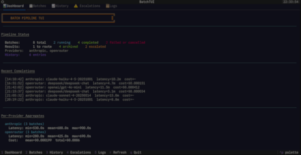
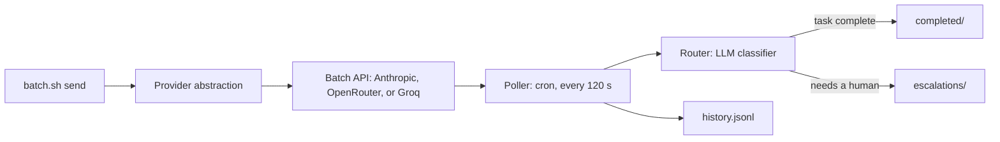

# Batch Processing Helper

Async batch-processing pipeline for LLM work. It submits tasks to the Anthropic, OpenRouter or Groq batch APIs, polls for results in the background, classifies each result with an LLM (archive or escalate), and records cost and latency for every batch. It lets you send a batch with a single command and review only the items that need human attention.



**Contents:** [TL;DR](#tldr) · [Why](#why) · [How it works](#how-it-works) · [Features](#features) · [Providers](#supported-providers) · [Quick start](#quick-start) · [Commands](#commands) · [Interfaces](#interfaces) · [Configuration](#configuration) · [Scheduling](#scheduling) · [Results and cost](#results-history-and-cost) · [Limitations](#limitations) · [Development](#development) · [License](#license)

## TL;DR [lines 11-22]

**Quick Overview:** Batch Processing Helper is an automation tool that lets you submit AI tasks to multiple providers (Anthropic, OpenRouter, Groq) and get results without waiting around.

**How It Works:** You write one command, send multiple prompts as a batch, and the system automatically:
- Polls for results every 2 minutes in the background
- Classifies each result using an AI classifier (archive vs. human review)
- Tracks costs, latency, and complete history
- Shows only items needing human attention

**Key Benefits:**
- **Cost-effective**: Batch APIs are ~50% cheaper than live calls
- **Time-saving**: Handles all the boring waiting and routing work automatically
- **Focused review**: You only see results that need human attention
- **Multi-provider support**: Works with Anthropic, OpenRouter, or Groq
- **Complete tracking**: Full cost and performance metrics for every batch

**Who It's For:**
- Running large-scale AI evaluations, labeling, content generation
- Any work where you don't need immediate answers
- Teams wanting to save money on AI API calls
- Developers needing automated AI task processing

**Bottom Line:** Think of it as an AI task processor that handles the operational overhead of batch processing so you can focus on reviewing only the interesting results — saving both money and time while getting complete visibility into your AI operations.

## Why

Batch APIs are cheaper than live calls and suit work where nobody is waiting for the answer: evaluations, labeling, large prompt runs. This project handles the operational loop—submit, poll, collect, check, and track—so you can send a task with one command and review only the results that need a person.

## How it works



1. **Submit.** `batch.sh send` builds one request per message and submits them together, as one batch, to the selected provider's batch API.
2. **Poll.** A scheduled job checks batch status every 2 minutes by default (`BATCH_POLL_INTERVAL`, applied when you install the cron job) and downloads finished results.
3. **Route.** An LLM classifier labels each result as `text`, `question`, `error` or `action_needed`. Results are archived or escalated to a human; any other route the classifier returns is escalated too. A routed result is kept as `<id>.routed` in `responses/` and is not classified again.
4. **Log.** Every completed batch is appended to a history file with provider, model, latency, token counts and cost.

Routing is automatic, but escalated items wait for a person to review them.

## Features

- Provider abstraction with three implementations today: Anthropic, OpenRouter, and Groq
- Background polling through cron
- LLM-based result router with archive and escalation outcomes
- Multi-request batches: `send` takes several messages, `send-file` a file of prompts, `--from-stdin` a pipe; the router handles each result on its own
- Unique id for every request (`<batch id>-0000`, `-0001`, …), all kept in the state file, the tracking file and the history
- Agent ownership: `--agent NAME` tags a batch with the agent or session that owns it, so several agents can share one pipeline
- Pre-submit review: `--dry-run` shows the batch (requests, ids, model, agent) without sending or writing anything
- CLI (`batch.sh`, with a Fish wrapper) and a five-tab terminal UI built with Textual
- Per-batch history with per-provider and per-model aggregates (latency, tokens, cost)
- Unit tests that run offline, plus optional live tests
- Reply cap per request with `--max-tokens N` (reasoning models count their thinking against it)
- MCP server (`batch-mcp.py`) with six tools for Claude Desktop and other MCP hosts
- Two skills: a Claude Code project skill (drives the `batch.sh` CLI) and a Claude Desktop skill (drives the MCP server; upload-ready zip included)

## Supported providers

| Provider | API used | Default model | Notes |
|---|---|---|---|
| Anthropic | Message Batches API | `claude-haiku-4-5-20251001` (`BATCH_MODEL`) | Claude models only |
| OpenRouter | OpenRouter Batch API | `OPENROUTER_BATCH_MODEL`, falling back to `BATCH_MODEL`, then `deepseek/deepseek-v4.1-flash` | Only models that offer a batch variant. The model ID is sent exactly as written. |
| Groq | Groq Batch API | `openai/gpt-oss-20b` (`GROQ_BATCH_MODEL`, then `BATCH_MODEL`) | Batches finish in seconds to minutes. Cost is not reported, so cost shows blank in history. The set of models usable for batch is shorter than the live list. |

**Additional notes**

- **OpenRouter example model IDs**: `anthropic/claude-3.5-haiku`, `openai/gpt-4o`, `google/gemini-2.0-flash-001`, `meta-llama/llama-3.3-70b-instruct`, `deepseek/deepseek-v4.1-flash`.
- **Groq model listing command**: `curl -s https://api.groq.com/openai/v1/models -H "Authorization: Bearer $GROQ_API_KEY"`.
- **Batch support check**: Verify that a model offers a batch variant before submitting; for OpenRouter check the models page filtered by batch support, for Groq use the listing command above.

## Quick start

Requirements: Linux or macOS, Python 3.9 or newer with `venv` (tested on 3.9 and 3.15), an API key for one provider, and optionally `jq` (pretty-prints the output of `send`).

```bash
git clone https://github.com/Hello-My-Name-Is-Kay/Batch-Processing-Helper.git
cd Batch-Processing-Helper
python -m venv venv
source venv/bin/activate
pip install -r requirements.txt
```

Set a key for one provider (never commit keys):

```bash
# Anthropic (default provider)
export ANTHROPIC_API_KEY="sk-..."

# or OpenRouter
export OPENROUTER_API_KEY="sk-..."
export BATCH_PROVIDER=openrouter

# or Groq
export GROQ_API_KEY="gsk_..."
export BATCH_PROVIDER=groq
```

Or keep them in a git-ignored `.env` file, which is also what the scheduled job reads:

```bash
cp .env.example .env    # then edit it
chmod 600 .env
```

Send a single task and check its status:

```bash
bash batch.sh send "Summarize the main trade-offs of batch APIs in three bullets"
bash batch.sh status
```

Send several prompts as ONE batch, list them, or put one prompt per line in a file (or JSON Lines with `message`, `system` and `id` fields):

```bash
bash batch.sh send "Task 1" "Task 2" "Task 3"
bash batch.sh send-file prompts.txt
cat tasks.txt | python3 batch-submit.py --from-stdin
```

Each request gets its own id (`<batch id>-0000`, `<batch id>-0001`, …) and its own result.
Add `--agent NAME` to record who owns the batch, and `--dry-run` to preview it first:

```bash
bash batch.sh --agent "my-session" --dry-run send "Task 1" "Task 2"
```

Cap the reply length with `--max-tokens N` (default 2048):

```bash
bash batch.sh --max-tokens 4096 send "Long answer task"
python3 batch-submit.py --max-tokens 4096 "Long answer task"
```

Finished batches are collected by the scheduler. Review them:

```bash
bash batch.sh history
bash batch.sh stats
```

Groq-specific details (default model, listing the models a key can use, partial failures) are in [Supported providers](#supported-providers).

## Commands

| Command | What it does |
|---|---|
| `bash batch.sh send "task" ["task" ...]` | Submit one or more tasks as one batch to the default provider |
| `bash batch.sh send-file prompts.txt` | Submit every prompt in a file as one batch |
| `bash batch.sh --agent NAME send "task"` | Record which agent or session owns the batch |
| `bash batch.sh --system "text" send "task"` | Set the system message for the requests |
| `bash batch.sh --dry-run send "task"` | Preview the batch without sending or writing anything |
| `bash batch.sh --provider openrouter --model "<model>" send "task"` | Submit with a specific provider and model |
| `bash batch.sh --provider groq --model "<model>" send "task"` | Submit with the Groq provider and a specific model |
| `bash batch.sh --max-tokens N send "task"` | Cap each reply's tokens at N (default 2048) |
| `bash batch.sh poll` | Run one poll and route cycle by hand (the scheduler does this for you) |
| `bash batch.sh status` | Show running, collected, awaiting-routing, escalated and archived counts |
| `bash batch.sh escalations` | List items that need a human decision |
| `bash batch.sh history [N]` | Show the last N completed batches (default 10) |
| `bash batch.sh stats` | Provider-side latency, tokens and cost per provider and per model |
| `bash batch.sh metrics` | End-to-end latency, routing time and throughput |
| `bash batch.sh logs` | View pipeline logs |
| `bash batch.sh providers` | List available providers |
| `bash batch.sh tui` | Open the terminal UI |

Flags go before the command, for example `bash batch.sh --provider groq --max-tokens 4000 --agent my-session send "Task"`. `--max-tokens` is also accepted by `batch-submit.py`.

## Interfaces

### Terminal UI

`bash batch.sh tui` opens a Textual interface that refreshes every 10 seconds.

| Key | Tab | Shows |
|---|---|---|
| `1` | Dashboard | Pipeline overview, counts, recent history, per-provider aggregates |
| `2` | Batches | All tracked batches with status, provider, model, age and latency |
| `3` | History | Completed batches plus per-provider and per-model stats |
| `4` | Escalations | Items waiting for human review |
| `5` | Logs | Tail of `poll.log` and `router.log` |

Press `r` to refresh and `q` to quit.

### MCP server and Claude Desktop

`batch-mcp.py` is a stdio MCP server. Tools: `batch_send` (one task per call, optional `provider` and `model`), `batch_status`, `batch_poll`, `batch_history`, `batch_stats` and `batch_escalations`. Multi-request batches, `--dry-run`, `--agent` and `--max-tokens` are CLI-only.

Add it to your host's MCP config (for Claude Desktop, `claude_desktop_config.json`), using the project's `venv` Python so the provider packages are available:

```json
{
  "mcpServers": {
    "batch-processing": {
      "command": "/path/to/Batch-Processing-Helper/venv/bin/python",
      "args": ["/path/to/Batch-Processing-Helper/batch-mcp.py"],
      "env": {
        "BATCH_PROVIDER": "groq",
        "GROQ_API_KEY": "<your key>"
      }
    }
  }
}
```

The MCP server does **not** read `.env`: put the provider's API key in the `env` block above. Restart the host after editing its config.

The Claude Desktop skill in `claude-desktop/batch-processing/SKILL.md` (upload-ready: `claude-desktop/batch-processing.zip`) teaches Claude to drive these tools and to say so when they are not connected.

### Claude Code skill

`.claude/skills/batch-processing/SKILL.md` is a project skill for Claude Code. It uses the `batch.sh` CLI rather than MCP: provider selection, dry-run, submit, poll, review, and a failure guide. `.agents/skills/batch-processing/SKILL.md` is the equivalent for Pi.

## Configuration

Set these as environment variables or edit `batch-config.sh`.

| Variable | Required | Purpose |
|---|---|---|
| `ANTHROPIC_API_KEY` | For Anthropic | Anthropic API key |
| `OPENROUTER_API_KEY` | For OpenRouter | OpenRouter API key |
| `GROQ_API_KEY` | For Groq | Groq API key |
| `BATCH_PROVIDER` | No | `anthropic` (default), `openrouter`, or `groq` |
| `BATCH_MODEL` | No | Batch model (provider-specific). Unset: the provider's default |
| `OPENROUTER_BATCH_MODEL` | No | OpenRouter model, defaults to `BATCH_MODEL` |
| `GROQ_BATCH_MODEL` | No | Groq batch model, defaults to `openai/gpt-oss-20b` |
| `OPENROUTER_REFERER`, `OPENROUTER_APP_NAME` | No | Attribution headers for OpenRouter |
| `ROUTER_MODEL` | No | Model used for the routing classifier. Unset: `claude-haiku-4-5-20251001` on Anthropic, the provider default on OpenRouter and Groq |
| `OPENROUTER_ROUTER_MODEL` | No | Routing model on OpenRouter, takes precedence over `ROUTER_MODEL` |
| `GROQ_COMPLETION_WINDOW` | No | Batch completion window (default 24 h) |
| `BATCH_POLL_INTERVAL` | No | Seconds between polls (default 120). Applied by `setup-cron`, rounded up to whole minutes |
| `BATCH_DIR` | No | Base directory for pipeline files |
| `BATCH_ENV_FILE` | No | Path of the `.env` file to load (default: `.env` in the project folder) |
| `BATCH_PYTHON` | No | Python interpreter to use (default: `venv/bin/python3` if present, else `python3`) |

`batch-config.sh` derives the request, response, completed, escalation, log and state paths from `BATCH_DIR`. Runtime data lives in `.batch-data/` and is git-ignored. The Python scripts use the same defaults when run on their own.

`.env` holds plain `KEY=VALUE` lines (see `.env.example`). It is read, not executed, and anything already set in your environment wins over it.

To check that a key is set without printing it:

```bash
[ -n "$ANTHROPIC_API_KEY" ] && echo "Anthropic key set" || echo "Anthropic key missing"
```

## Scheduling

Polling runs from cron. `setup-cron` installs the job, using `BATCH_POLL_INTERVAL` (default every 2 minutes). Running it again updates this project's entry and leaves your other cron entries alone.

```bash
bash batch-orchestrator.sh setup-cron
crontab -l | grep batch-orchestrator
```

Cron does not inherit your shell's exports, so put your API key in `.env` (see above). The job uses the project's `venv/` automatically, and any error from the poll or router is written to `.batch-data/logs/orchestrator.log`.

systemd unit files are not included in this repository yet, so use cron on both Linux and macOS. On macOS a `launchd` agent also works but is less reliable for timers.

## Results, history and cost

- **Result locations**
  * Successful responses are written to `responses/<id>.routed`.
  * Completed batches are stored as `completed/<custom_id>.done`.
  * Results that need a person (and failed requests) are written to `escalations/<custom_id>.escalate`.

- **History and metrics**
  * `history.jsonl` (in `.batch-data/history/`) logs each poll-collected batch with provider, model, timestamps, request counts, tokens, and cost (if reported).
  * `stats` aggregates this log per provider and per model, reporting count, min, max, mean, median, and sum for latency, tokens, and cost.
  * `metrics` reports end-to-end pipeline latency (submit → collected), routing time, throughput, and archived result counts. It reads `.batch-state` and `completed/*.done`.

- **Cost caveats**
  * Anthropic cost is not estimated; its history entries contain only tokens.
  * Groq does not report cost; its history entries show a blank cost field.
  * Batch calls are usually priced at a discount to live calls (typically about 50%); check each model's page before estimating savings.
  * OpenRouter reports cost: a single early smoke test (3 requests, 352 tokens, DeepSeek) cost about $0.000034. That is too small to draw savings conclusions from, so measure your own workload with `history` and `stats`.
  * On Groq, a 30-request batch used 4,052 tokens.
  * Cost is only recorded when the provider supplies it; otherwise the field is empty.

## Limitations

- **Latency.** Batches usually finish in minutes (Groq: seconds to minutes) but can take up to 24 hours. This is not for interactive use.
- **Partial failures.** A batch can finish with some requests failed. The good results are archived and the failed ones are escalated with the provider's error.
- **No cancellation on OpenRouter.** Batches cannot be cancelled once submitted, and results are deleted after 30 days.
- **OpenRouter constraints.** One model per batch, text and public image URLs only, no Zero Data Retention and no provider sorting.
- **Groq.** Cost is not reported (the cost column stays blank), and the models usable for batch are fewer than the live list.
- **Router cost.** Every result gets one small live LLM call to classify it, so a batch of N results costs N extra calls. If that call fails, the result is escalated with the real error as the reason.
- **No retries.** Transient provider failures are not retried yet.
- **Live verification.** Groq was exercised against the real API (a 30-request batch, a batch with invalid requests, a failed batch, the MCP tools, the orchestrator and the TUI). OpenRouter was smoke-tested earlier. The Anthropic path is covered by unit tests with fakes only.
- **Platform support.** Tested on Linux. macOS works with cron.

See [ISSUES.md](ISSUES.md) for the full list of known issues.

## Development

### Adding a provider

1. Subclass `BatchProvider` (see `providers/base.py`) in a new file under `providers/`.
   Implement `get_provider_name`, `build_request`, `create_batch`, `retrieve_batch` and `get_results`.
2. Make `retrieve_batch()` return `model`, `usage` (prompt, completion and total tokens plus cost) and `request_counts` (total, completed, failed).
3. Register it in `providers/__init__.py` as a module name and class name:
   ```python
   _PROVIDERS["myprovider"] = (".myprovider", "MyProvider")
   ```
   The module is only imported when that provider is used.
4. Add any new environment variables to `batch-config.sh` and `.env.example`.

`providers/openrouter_provider.py` is a complete reference implementation for JSON batch APIs. `providers/groq_provider.py` is a second one, for file-based batches: it uploads a JSONL file, creates the batch from it, and downloads the output and error files.

### Tests

```bash
python3 test_batch_pipeline.py --unit                  # offline, no API calls
python3 test_batch_pipeline.py --live                  # needs OPENROUTER_API_KEY
python3 test_batch_pipeline.py                         # everything
python3 test_batch_pipeline.py --unit --filter P1-12   # only tests whose name contains the text
ruff check .                                           # lint (settings in pyproject.toml)
```

Unit tests run offline with fake providers. They cover the providers, the full submit → poll → route flow, the shell wrappers and cron setup, the state file, the router, history, the TUI (headless) and the MCP server. Live tests are skipped when no API key is set. On GitHub, `.github/workflows/ci.yml` runs `ruff check .` and `python test_batch_pipeline.py --unit` on Python 3.9 and 3.12 for every push to `main` and every pull request. Run `pip install ruff` to lint locally.

### Project layout

```
batch.sh, batch.fish          CLI wrappers
batch-submit.py               Submit requests
batch-poll.py                 Poll batch status and collect results
batch-router.py               LLM result classifier and router
batch-status.py               Status view
batch-metrics.py              Provider metrics
batch-mcp.py                  MCP server (Claude Desktop and other hosts)
batch_history.py              History and aggregates
batch_common.py               Shared folder defaults and atomic JSON writes
batch_tui.py                  Terminal UI
batch-orchestrator.sh         Scheduling (cron)
batch-config.sh               Configuration (also loads .env)
.env.example                  Template for API keys and overrides
providers/                    base.py plus the Anthropic, OpenRouter and Groq providers
.claude/skills/               Claude Code skill
.agents/skills/               Pi skill
claude-desktop/               Claude Desktop skill and upload-ready zip
test_batch_pipeline.py        Tests
pyproject.toml                Project metadata, dependencies, lint settings
.github/workflows/ci.yml      CI: ruff and the unit tests on Python 3.9 and 3.12
docs/tui.gif                  Terminal UI demo shown at the top of this README
.batch-data/                  Runtime data (git-ignored)
PIPELINE.md, METRICS.md,
SETUP.md, ISSUES.md           Extra documentation (internals, metrics, troubleshooting, known issues)
AUDIT.md                      Audit report and fix log
```

### Roadmap

- Retry logic for transient provider failures
- Request timeouts for the Anthropic client
- Escalation notifications (Slack or webhook)
- Multi-step chains: re-queue a result as the next request
- Integration tests for all providers
- Provider performance comparison dashboard

## License

MIT. A `LICENSE` file has not been added to the repository yet.
