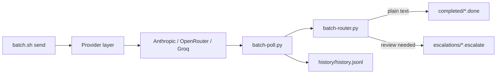

# Batch Processing Helper

Async batch processing for LLM work. Submit prompts to **Anthropic, OpenRouter, or Groq**, poll for completion, route results for review, and track latency, tokens, and cost.

The project provides three interfaces over the same provider layer:

- **CLI** — submit and monitor batches from scripts or a terminal.
- **MCP server** — expose pipeline operations to Pi, Claude Desktop, and other MCP hosts.
- **HTTP chat gateway** — turn OpenAI-compatible chat requests into provider batches.

**Contents:** [Features](#features) · [Supported providers](#supported-providers) · [Quick start](#quick-start) · [Commands](#commands) · [How it works](#how-it-works) · [MCP server](#mcp-server) · [Chat gateway](#chat-gateway) · [Configuration](#configuration) · [Results and metrics](#results-and-metrics) · [Development](#development) · [Limitations](#limitations)

## Features

- Three verified provider integrations: Anthropic, OpenRouter, and Groq
- Multi-request batches with one provider request per prompt
- Background polling through `batch-orchestrator.sh` and cron
- LLM classification into archived text and human-review escalations
- Persistent history with provider/model latency, token, and cost metrics
- Interactive Textual TUI
- MCP tools for status, submission, polling, history, and escalations
- OpenAI-compatible HTTP gateway for Groq and OpenRouter
- Owner-only private credential setup
- Claude Code, Claude Desktop, and generic agent skills
- Offline regression suite with optional live tests

## Supported providers

| Provider | Credential | Default model | Verification |
|---|---|---|---|
| **Anthropic** | `ANTHROPIC_API_KEY` | Provider default | Offline integration tests |
| **OpenRouter** | `OPENROUTER_API_KEY` | `deepseek/deepseek-v4.1-flash` | Smoke-tested and offline-tested |
| **Groq** | `GROQ_API_KEY` | `openai/gpt-oss-20b` | Live-tested and offline-tested |

Provider availability and supported batch models can change. Check the provider's current documentation before submitting paid work.

## Quick start

Requirements: Linux or macOS, Python 3.9 or newer, and an API key for one provider.

```bash
git clone https://github.com/Hello-My-Name-Is-Kay/Batch-Processing-Helper.git
cd Batch-Processing-Helper
python3 -m venv venv
source venv/bin/activate
pip install -r requirements.txt
```

Configure a key in the environment or in the git-ignored `.env` file:

```bash
cp .env.example .env
chmod 600 .env
```

```dotenv
BATCH_PROVIDER=groq
GROQ_API_KEY=gsk_...
```

Submit a batch and inspect its state:

```bash
bash batch.sh send "Summarize batch APIs in three bullets"
bash batch.sh status
bash batch.sh poll
```

Use `--dry-run` before the first paid submission:

```bash
bash batch.sh --provider groq --dry-run send "Summarize batch APIs in three bullets"
```

## Commands

| Command | Purpose |
|---|---|
| `bash batch.sh send "task" ["task" ...]` | Submit one or more prompts as one batch |
| `bash batch.sh send-file FILE` | Submit prompts from a text or JSONL file as one batch |
| `bash batch.sh --provider NAME send "task"` | Select Anthropic, OpenRouter, or Groq |
| `bash batch.sh --model MODEL send "task"` | Select a provider-specific model |
| `bash batch.sh --agent NAME send "task"` | Record the owner/session |
| `bash batch.sh --system TEXT send "task"` | Add a system message |
| `bash batch.sh --max-tokens N send "task"` | Cap each response |
| `bash batch.sh --dry-run send "task"` | Validate and preview without sending |
| `bash batch.sh poll` | Run one poll-and-route cycle |
| `bash batch.sh status [--json]` | Show pipeline state |
| `bash batch.sh escalations` | Show results requiring review |
| `bash batch.sh history [N]` | Show recent history |
| `bash batch.sh stats` | Show per-provider/model aggregates |
| `bash batch.sh metrics [--json FILE]` | Show end-to-end latency and throughput |
| `bash batch.sh logs` | Show recent orchestrator logs |
| `bash batch.sh providers` | List supported providers |
| `bash batch.sh tui` | Launch the terminal UI |
| `python3 chat_batch.py "message"` | Submit one chat message as a batch and wait for its reply |

Global flags must appear before the command. Run `bash batch.sh help` for the built-in reference.

### Background polling

Install a cron entry that polls every `BATCH_POLL_INTERVAL` seconds:

```bash
bash batch-orchestrator.sh setup-cron
crontab -l
```

The cron entry runs `batch-orchestrator.sh poll`. Remove the matching line from `crontab -e` to disable polling.

## How it works



1. `batch_submit.py` validates prompts, IDs, credentials, and storage before submission.
2. The selected provider creates one batch containing all requests.
3. `batch-poll.py` asks unfinished batches for status and downloads completed results.
4. `batch-router.py` classifies each result independently with a live model call.
5. Plain text is archived; questions, errors, action requests, and unparseable results are escalated for a person.
6. Completed batches are appended to the history file with provider/model metrics.

See [PIPELINE.md](PIPELINE.md) for internals and [METRICS.md](METRICS.md) for metric definitions.

## MCP server

`batch-mcp.py` is a newline-delimited JSON-RPC server over stdio. stdout is reserved for JSON-RPC; diagnostics go to stderr.

| Tool | Purpose |
|---|---|
| `batch_providers` | List providers and Groq/OpenRouter credential presence |
| `batch_models` | Fetch Groq's complete live model catalog |
| `batch_send` | Submit one task with optional provider and model |
| `batch_status` | Show tracked batch counts and recent activity |
| `batch_poll` | Run one collection/routing cycle |
| `batch_history` | Return completion metrics |
| `batch_stats` | Return provider/model aggregates |
| `batch_escalations` | List results awaiting review |

A successful `batch_send` returns a **batch ID, not the model's answer**. Poll separately. Full responses are stored under the runtime responses directory.

### Configure Pi

Add the server to `~/.pi/agent/mcp.json` or `.pi/mcp.json`:

```json
{
  "mcpServers": {
    "batch-processing": {
      "command": "/absolute/path/to/checkout/venv/bin/python",
      "args": ["/absolute/path/to/checkout/batch-mcp.py"],
      "cwd": "/absolute/path/to/checkout",
      "env": {
        "BATCH_PROVIDER": "groq",
        "GROQ_API_KEY": "gsk_..."
      },
      "timeout": 120
    }
  }
}
```

For OpenRouter, Pi can supply its existing credential without copying it:

```json
"OPENROUTER_API_KEY": "!pi auth print-api-key --provider openrouter"
```

Run `pi mcp list` to verify the connection. Use `/reload` after changing MCP configuration.

### Private credential setup

The MCP server can store provider keys outside the repository:

```bash
venv/bin/python batch-mcp.py --setup
```

Keys are stored in plaintext with owner-only permissions at:

```text
~/.config/batch-processing-helper/credentials.json
```

The setup menu accepts Anthropic, OpenRouter, and Groq keys. Saved values override inherited environment values for the MCP process. Never commit or paste key values into chat, logs, or issues.

## Chat gateway

`batch_gateway.py` exposes an OpenAI-compatible endpoint at `http://127.0.0.1:8787/v1`. Client requests are merged into provider batches. Provider keys stay inside the gateway; clients authenticate with gateway keys.

### Start the gateway

```bash
./start-server.sh               # background
./start-server.sh --foreground  # current terminal
./start-server.sh --mcp         # stdio MCP server, not HTTP
./start-server.sh --help
```

Fish equivalents are available through `./start-server.fish`.

Management commands:

```bash
venv/bin/python batch_gateway.py stats
venv/bin/python batch_gateway.py restart
venv/bin/python batch_gateway.py stop
```

The gateway supports:

- `POST /v1/chat/completions`
- `GET /v1/models`
- `GET /v1/gateway/stats` for administrators
- `GET /health`

Streaming is emulated with keep-alive responses because provider batches do not stream natively. Embeddings, images, audio, and `n > 1` are not supported.

### Configure Pi's model picker

```json
{
  "providers": {
    "batch-gateway": {
      "baseUrl": "http://127.0.0.1:8787/v1",
      "api": "openai-completions",
      "apiKey": "!batch-gateway token",
      "models": [
        {"id": "openai/gpt-oss-120b", "name": "GPT OSS 120B (Groq batch)"}
      ]
    }
  }
}
```

`batch-gateway token` prints the gateway key; do not paste its output into logs. For a checkout-only installation, use an absolute command such as:

```text
!/absolute/path/to/checkout/venv/bin/python /absolute/path/to/checkout/batch_gateway.py token
```

OpenRouter batch models are discovered from the live catalog and exposed with an `openrouter/` prefix. Refresh an existing literal-key Pi configuration with:

```bash
venv/bin/python sync_pi_batch_models.py
```

The sync script backs up Pi's model configuration, preserves unrelated entries, and leaves the default model unchanged.

Gateway files:

```text
~/.config/batch-gateway/keys.json              private gateway keys
~/.local/state/batch-gateway/gateway.log        gateway logs
~/.local/state/batch-gateway/ledger.jsonl       request outcomes and usage
```

Override these locations with `BATCH_GATEWAY_HOME` and `BATCH_GATEWAY_STATE`.

## Configuration

Copy `.env.example` to `.env` and keep it private. Plain `KEY=VALUE` lines are supported; existing environment variables take precedence.

| Variable | Default | Purpose |
|---|---|---|
| `BATCH_PROVIDER` | `anthropic` | `anthropic`, `openrouter`, or `groq` |
| `BATCH_MODEL` | Provider-specific | Shared model fallback |
| `ANTHROPIC_API_KEY` | unset | Anthropic credential |
| `OPENROUTER_API_KEY` | unset | OpenRouter credential |
| `GROQ_API_KEY` | unset | Groq credential |
| `GROQ_BATCH_MODEL` | `openai/gpt-oss-20b` | Groq model override |
| `OPENROUTER_BATCH_MODEL` | `deepseek/deepseek-v4.1-flash` | OpenRouter model override |
| `ROUTER_MODEL` | Provider-specific | Model used for live classification |
| `BATCH_POLL_INTERVAL` | `120` | Seconds between cron polls |
| `BATCH_DIR` | `.batch-data/` | Runtime data directory |
| `PROJECT_DIR` | unset | Project context directory used by the router |
| `PROJECT_CONTEXT_FILE` | unset | Explicit routing-context file |

## Results and metrics

Runtime data lives under `.batch-data/` by default:

| Location | Contents |
|---|---|
| `responses/*.result` | Downloaded results awaiting routing |
| `responses/*.routed` | Routed results with metadata |
| `completed/*.done` | Archived plain-text results |
| `escalations/*.escalate` | Results requiring human review |
| `history/history.jsonl` | Completed-batch history |
| `.batch-state` | Tracked provider batches |
| `logs/` | Poll, router, and orchestrator logs |

```bash
bash batch.sh history 5
bash batch.sh stats
bash batch.sh metrics
```

## Development

### Tests

```bash
python3 test_batch_pipeline.py --unit
python3 -m unittest test_batch_credentials test_mcp_regressions test_batch_gateway
ruff check .
```

The default suite skips live API tests. To run the optional OpenRouter live test:

```bash
python3 test_batch_pipeline.py --live
```

Live tests can incur provider charges.

### Adding a provider

1. Implement `BatchProvider` from `providers/base.py` in `providers/<name>_provider.py`.
2. Implement `get_provider_name`, `build_request`, `create_batch`, `retrieve_batch`, and `get_results`.
3. Return normalized status, request counts, timestamps, and optional usage/cost from `retrieve_batch`.
4. Register the provider in `providers/__init__.py`.
5. Add its credential to `batch-config.sh`, `.env.example`, and `batch_credentials.py`.
6. Add offline tests before advertising it as supported.

`providers/openrouter_provider.py` is the JSON-batch reference. `providers/groq_provider.py` is the file-upload reference.

### Project layout

```text
batch.sh, batch.fish              Main CLI wrappers
batch-chat.fish                    Fish wrapper for one-message batch chat
batch-submit.py                    Legacy alias for batch_submit.py
batch_submit.py                    Submit requests
batch-poll.py                      Poll providers and collect results
batch-router.py                    Classify and route results
batch-status.py                    Pipeline status
batch-metrics.py                   Latency and throughput metrics
batch_history.py                   Persistent history and aggregates
batch_tui.py                       Textual terminal UI
batch-orchestrator.sh              Poll/router job and cron setup
batch-mcp.py                       Stdio MCP server
batch_credentials.py               Private credential setup
batch_gateway.py                   OpenAI-compatible batch gateway
sync_pi_batch_models.py            Refresh Pi gateway model entries
providers/                         Anthropic, OpenRouter, and Groq providers
docs/tui.gif                        TUI demonstration
```

## Limitations

- Groq has been exercised against the live API. OpenRouter has been smoke-tested. Anthropic is covered by offline integration tests only.
- The pipeline does not automatically resubmit failed paid batches. Check the existing batch ID before retrying to avoid duplicate charges.
- Provider batch models and limits change over time.
- Escalations are files; no notification system is included.
- Anthropic history may contain tokens without a cost estimate.
- State locking uses POSIX `flock`; Windows and some network filesystems are unsupported.
- The gateway binds to localhost by default. Do not expose it publicly without a separate authentication and network-security layer.

## License

[MIT](LICENSE)
