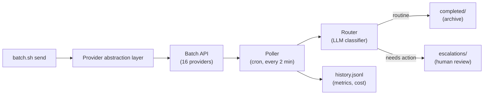

# Batch Processing Helper

Async batch-processing pipeline for LLM work. Submit tasks to **16 AI providers**, poll for results automatically, classify outputs with an LLM, and track costs/latency. Send a batch with one command. Review only the items that need attention.

**Contents:** [TL;DR](#tldr) · [Why](#why) · [How it works](#how-it-works) · [Features](#features) · [16 Providers](#supported-providers-16-total) · [Quick start](#quick-start) · [Commands](#commands) · [Retry & Export](#retry--export) · [Results and cost](#results-history-and-cost) · [Development](#development) · [License](#license)

---

## TL;DR

**What:** A batch processing automation tool for AI tasks. Submit prompts to 16 different AI providers, the system polls and collects results, classifies them (keep or escalate), and tracks everything.

**How:** One command sends a batch. The system:
- Polls for results every 2 minutes (in background, via cron)
- Uses an LLM to classify results (archive vs. needs-human-review)
- Tracks cost, latency, token usage
- Routes completed work vs. escalations

**Why:** Batch APIs are ~50% cheaper than live calls, perfect for non-urgent work (evaluations, labeling, bulk processing).

**Key Features:**
- **16 providers** — Anthropic, OpenRouter, Groq, QWEN, DeepSeek, Claude, Gemini, Together, Mistral, Replicate, HuggingFace, Modal, Baseten, Fireworks, Lambda, Anyscale
- **Retry logic** — Exponential backoff for failed batches (1s, 2s, 4s, 8s... up to 5min)
- **Export** — Download results as CSV, JSON, SQLite, Parquet
- **Cost tracking** — Per-request, per-provider, per-model metrics
- **MCP + Skills** — Claude Desktop integration, Claude Code skill included

**For:** Large-scale evaluations, content generation, prompt testing, labeling, any work where results don't need to be instant.

---

## Why

Batch APIs cost 40–50% less than live API calls but require polling and result handling. This project automates that loop so you can:
- Send a batch with one command
- Forget about it (scheduler handles polling)
- Review only the results that matter (LLM classifier auto-archives routine ones)
- Track every cost and latency metric

---

## How it works



**Flow:**
1. **Submit** — `batch.sh send` packages prompts, sends them to the chosen provider
2. **Poll** — Scheduler checks batch status every 2 minutes, downloads results
3. **Route** — Classifier labels each result (auto-archive routine ones, escalate others)
4. **Log** — Track cost, latency, token usage per batch

---

## Features

- **16 Batch Providers** (see [Supported Providers](#supported-providers-16-total) below)
- **Retry Logic** — Exponential backoff, configurable max retries
- **Background Polling** — Cron job checks every 2 minutes (configurable)
- **LLM Classifier** — Auto-archive routine results, escalate ones needing review
- **Multi-request Batches** — Single batch contains many requests; each gets its own result
- **Unique IDs** — Every request traceable (`<batch_id>-0000`, `-0001`, …)
- **Agent Ownership** — Tag batches with `--agent NAME` for shared pipelines
- **Dry-run Preview** — `--dry-run` shows batch before sending
- **CLI + Terminal UI** — `bash batch.sh` or `bash batch.sh tui` (5-tab Textual dashboard)
- **Cost Tracking** — Per-request, per-provider, per-model aggregates (latency, tokens, cost)
- **Export Results** — CSV, JSON, SQLite, Parquet formats
- **MCP Server** — Claude Desktop integration (`batch-mcp.py`)
- **Skills** — Claude Code skill + Claude Desktop skill
- **Unit Tests** — Offline tests, optional live tests with real providers

---

## Supported Providers (16 Total)

| # | Provider | Setup | Default Model | Use Case |
|---|----------|-------|---------------|----------|
| 1 | **Anthropic** | `ANTHROPIC_API_KEY` | claude-opus-4-1 | Premium, reliable |
| 2 | **OpenRouter** | `OPENROUTER_API_KEY` | deepseek-v4 | Multi-model aggregator |
| 3 | **Groq** | `GROQ_API_KEY` | openai/gpt-oss-20b | Ultra-fast, cheap |
| 4 | **QWEN** | `QWEN_API_KEY` | qwen-turbo | Alibaba, competitive pricing |
| 5 | **DeepSeek** | `DEEPSEEK_API_KEY` | deepseek-chat | High performance, affordable |
| 6 | **Claude** | `ANTHROPIC_API_KEY` | claude-opus-4-1 | Direct Claude batching |
| 7 | **Gemini** | `GOOGLE_API_KEY` | gemini-1.5-pro | Google's latest models |
| 8 | **Together** | `TOGETHER_API_KEY` | meta-llama/Llama-3-70b | Open-source models |
| 9 | **Mistral** | `MISTRAL_API_KEY` | mistral-large | European LLM provider |
| 10 | **Replicate** | `REPLICATE_API_KEY` | open-source via Replicate | Reproducible ML |
| 11 | **HuggingFace** | `HF_API_KEY` | any HF model | ML community standard |
| 12 | **Modal** | `MODAL_TOKEN_ID` + `MODAL_TOKEN_SECRET` | user-deployed | Serverless functions |
| 13 | **Baseten** | `BASETEN_API_KEY` | deployed models | ML model serving |
| 14 | **Fireworks** | `FIREWORKS_API_KEY` | fireworks/llama-v2 | Optimized fast inference |
| 15 | **Lambda** | `LAMBDA_API_KEY` | custom GPU models | GPU cloud compute |
| 16 | **Anyscale** | `ANYSCALE_API_KEY` | LLM endpoints | Ray-based distributed ML |

**Quick Provider Comparison:**
- **Budget-conscious:** Groq, QWEN, DeepSeek
- **Reliability:** Anthropic, Gemini, Mistral
- **Open Source:** Together, Replicate, HuggingFace
- **Specialized:** Modal (serverless), Lambda (GPU), Anyscale (distributed)

---

## Quick start

Requirements: Linux or macOS, Python 3.9+, an API key for at least one provider.

```bash
git clone https://github.com/Hello-My-Name-Is-Kay/Batch-Processing-Helper.git
cd Batch-Processing-Helper
python -m venv venv
source venv/bin/activate
pip install -r requirements.txt
```

Set an API key (or put in `.env`):

```bash
# Pick one provider:
export GROQ_API_KEY="gsk_..."              # or
export ANTHROPIC_API_KEY="sk-..."           # or
export MISTRAL_API_KEY="..."
```

Send a test batch:

```bash
bash batch.sh send "Summarize batch APIs in 3 bullets"
bash batch.sh status
```

---

## Commands

| Command | What it does |
|---------|------------|
| `bash batch.sh send "task" ["task" ...]` | Submit tasks to default provider |
| `bash batch.sh --provider groq send "task"` | Submit to specific provider |
| `bash batch.sh --dry-run send "task"` | Preview batch (no send) |
| `bash batch.sh --agent NAME send "task"` | Tag batch with agent name |
| `bash batch.sh --max-tokens 4096 send "task"` | Cap reply length |
| `bash batch.sh status` | Show pipeline status (running, collected, escalated) |
| `bash batch.sh escalations` | List items needing human review |
| `bash batch.sh history [N]` | Show last N completed batches |
| `bash batch.sh stats` | Provider & model performance metrics |
| `bash batch.sh metrics` | End-to-end pipeline latency & throughput |
| `bash batch.sh tui` | Open terminal UI (5 tabs: dashboard, batches, history, escalations, logs) |
| `bash batch.sh providers` | List all 16 available providers |
| `python batch_retry.py ready` | Show batches ready for retry |
| `python batch_retry.py status` | Retry queue statistics |

---

## Retry & Export

### Retry Logic
Failed batches are automatically retried with exponential backoff:
- **Backoff:** 1s → 2s → 4s → 8s → ... → 5min max
- **Max retries:** 3 (configurable)
- **Persistent queue:** `.batch-data/retry-queue.jsonl`

```bash
python batch_retry.py status       # See queue stats
python batch_retry.py ready        # Batches ready to retry now
python batch_retry.py add <id> groq "Network timeout"  # Manually add
```

### Export Results
Export completed results in multiple formats:

```bash
bash batch.sh export --format csv --output results.csv
bash batch.sh export --format json --output results.json
bash batch.sh export --format sqlite --output results.db
```

---

## Configuration

Set in `.env` (git-ignored) or pass as environment variables:

| Variable | Default | Purpose |
|----------|---------|---------|
| `BATCH_PROVIDER` | anthropic | Default provider (anthropic, groq, mistral, etc.) |
| `BATCH_MODEL` | [provider-specific] | Model for batch |
| `BATCH_POLL_INTERVAL` | 120 | Seconds between polls (cron job) |
| `BATCH_DIR` | `.batch-data/` | Runtime data directory |

---

## Results, history, and cost

**Result locations:**
- `responses/<id>.routed` — Completed results with metadata
- `completed/<id>.done` — Archived results (routine ones)
- `escalations/<id>.escalate` — Results needing human review
- `history.jsonl` — Log of all batches with metrics

**Metrics tracked:**
- Per-request: latency, input tokens, output tokens, cost
- Per-batch: provider, model, total tokens, total cost
- Per-provider/model: min, max, mean latency; total cost

**Example:**
```bash
bash batch.sh history 5      # Last 5 completed batches
bash batch.sh stats          # Aggregates by provider & model
```

---
- **Live verification.** Groq was exercised against the real API (a 30-request batch, a batch with invalid requests, a failed batch, the MCP tools, the orchestrator and the TUI). OpenRouter was smoke-tested earlier. The Anthropic path is covered by unit tests with fakes only.
- **Platform support.** Tested on Linux. macOS works with cron.

See [ISSUES.md](ISSUES.md) for the full list of known issues.

## Development

### Adding a provider

1. Subclass `BatchProvider` (see `providers/base.py`) in a new file under `providers/`.
   Implement `get_provider_name`, `build_request`, `create_batch`, `retrieve_batch` and `get_results`.
2. Make `retrieve_batch()` return `model`, `usage` (prompt, completion and total tokens plus cost) and `request_counts` (total, completed, failed).
3. Register it in `providers/__init__.py` as a module name and class name:
   ```python
   _PROVIDERS["myprovider"] = (".myprovider", "MyProvider")
   ```
   The module is only imported when that provider is used.
4. Add any new environment variables to `batch-config.sh` and `.env.example`.

`providers/openrouter_provider.py` is a complete reference implementation for JSON batch APIs. `providers/groq_provider.py` is a second one, for file-based batches: it uploads a JSONL file, creates the batch from it, and downloads the output and error files.

### Tests

```bash
python3 test_batch_pipeline.py --unit                  # offline, no API calls
python3 test_batch_pipeline.py --live                  # needs OPENROUTER_API_KEY
python3 test_batch_pipeline.py                         # everything
python3 test_batch_pipeline.py --unit --filter P1-12   # only tests whose name contains the text
ruff check .                                           # lint (settings in pyproject.toml)
```

## Development

### Adding a provider

1. Create `providers/myapi_provider.py` subclassing `BatchProvider`
2. Implement: `create_batch()`, `retrieve_batch()`, `get_results()`, `build_request()`
3. Register in `providers/__init__.py`
4. Add tests in `test_new_providers_2.py`

See `providers/mistral_provider.py` for a reference implementation.

### Tests

```bash
python3 test_batch_pipeline.py --unit                  # Offline
python3 test_batch_pipeline.py --live                  # Real API (slow)
python3 test_batch_pipeline.py                         # Both
```

### Project layout

```
batch.sh, batch.fish          CLI wrappers
batch-submit.py               Submit requests
batch-poll.py                 Poll batch status
batch-router.py               LLM result classifier
batch-retry.py                Retry queue with backoff
batch-status.py               Status view
batch-metrics.py              Metrics aggregation
batch-mcp.py                  MCP server (Claude Desktop)
batch_tui.py                  Terminal UI (5 tabs)
batch-orchestrator.sh         Cron job scheduler
providers/                    16 provider implementations
.batch-data/                  Runtime data (git-ignored)
requirements.txt              Python dependencies
tests/                        Unit + integration tests
docs/                         Provider guides, troubleshooting
```

---

## License

MIT
