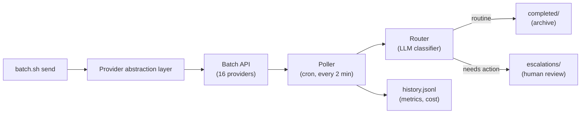

# Batch Processing Helper

Async batch-processing pipeline for LLM work. Submit tasks to **16 AI providers**, poll for results automatically, classify outputs with an LLM, and track costs/latency. Send a batch with one command. Review only the items that need attention.

**Contents:** [TL;DR](#tldr) · [Why](#why) · [How it works](#how-it-works) · [Features](#features) · [16 Providers](#supported-providers-16-total) · [Quick start](#quick-start) · [Commands](#commands) · [MCP](#mcp-server) · [Pi batch models](#pi-batch-models-groq-and-openrouter) · [Configuration](#configuration) · [Retry & Export](#retry--export) · [Results and cost](#results-history-and-cost) · [Development](#development) · [License](#license)

---

## TL;DR

**What:** A batch processing automation tool for AI tasks. Submit prompts to 16 different AI providers, the system polls and collects results, classifies them (keep or escalate), and tracks everything.

**How:** One command sends a batch. The system:
- Polls for results every 2 minutes (in background, via cron)
- Uses an LLM to classify results (archive vs. needs-human-review)
- Tracks cost, latency, token usage
- Routes completed work vs. escalations

**Why:** Batch APIs are ~50% cheaper than live calls, perfect for non-urgent work (evaluations, labeling, bulk processing).

**Key Features:**
- **16 providers** — Anthropic, OpenRouter, Groq, QWEN, DeepSeek, Claude, Gemini, Together, Mistral, Replicate, HuggingFace, Modal, Baseten, Fireworks, Lambda, Anyscale
- **Retry logic** — Exponential backoff for failed batches (1s, 2s, 4s, 8s... up to 5min)
- **Export** — Download results as CSV, JSON, SQLite, Parquet
- **Cost tracking** — Per-request, per-provider, per-model metrics
- **MCP + Skills** — Claude Desktop integration, Claude Code skill included

**For:** Large-scale evaluations, content generation, prompt testing, labeling, any work where results don't need to be instant.

---

## Why

Batch APIs cost 40–50% less than live API calls but require polling and result handling. This project automates that loop so you can:
- Send a batch with one command
- Forget about it (scheduler handles polling)
- Review only the results that matter (LLM classifier auto-archives routine ones)
- Track every cost and latency metric

---

## How it works



**Flow:**
1. **Submit** — `batch.sh send` packages prompts, sends them to the chosen provider
2. **Poll** — Scheduler checks batch status every 2 minutes, downloads results
3. **Route** — Classifier labels each result (auto-archive routine ones, escalate others)
4. **Log** — Track cost, latency, token usage per batch

---

## Features

- **16 Batch Providers** (see [Supported Providers](#supported-providers-16-total) below)
- **Retry Logic** — Exponential backoff, configurable max retries
- **Background Polling** — Cron job checks every 2 minutes (configurable)
- **LLM Classifier** — Auto-archive routine results, escalate ones needing review
- **Multi-request Batches** — Single batch contains many requests; each gets its own result
- **Unique IDs** — Every request traceable (`<batch_id>-0000`, `-0001`, …)
- **Agent Ownership** — Tag batches with `--agent NAME` for shared pipelines
- **Dry-run Preview** — `--dry-run` shows batch before sending
- **CLI + Terminal UI** — `bash batch.sh` or `bash batch.sh tui` (5-tab Textual dashboard)
- **Cost Tracking** — Per-request, per-provider, per-model aggregates (latency, tokens, cost)
- **Export Results** — CSV, JSON, SQLite, Parquet formats
- **MCP Server** — Claude Desktop and Pi integration (`batch-mcp.py`). Use `batch_models` (optional `provider: "groq"`) to fetch the complete live Groq catalog from `GET https://api.groq.com/openai/v1/models`, authenticated with `GROQ_API_KEY`. All returned models and metadata are preserved; catalog membership does not guarantee batch chat support.
- **Skills** — Claude Code skill + Claude Desktop skill
- **Unit Tests** — Offline tests, optional live tests with real providers

---

## Supported Providers (16 Total)

| # | Provider | Setup | Default Model | Use Case |
|---|----------|-------|---------------|----------|
| 1 | **Anthropic** | `ANTHROPIC_API_KEY` | claude-opus-4-1 | Premium, reliable |
| 2 | **OpenRouter** | `OPENROUTER_API_KEY` | deepseek/deepseek-v4.1-flash | Multi-model aggregator |
| 3 | **Groq** | `GROQ_API_KEY` | openai/gpt-oss-20b | Ultra-fast, cheap |
| 4 | **QWEN** | `QWEN_API_KEY` | qwen-turbo | Alibaba, competitive pricing |
| 5 | **DeepSeek** | `DEEPSEEK_API_KEY` | deepseek-chat | High performance, affordable |
| 6 | **Claude** | `ANTHROPIC_API_KEY` | claude-opus-4-1 | Direct Claude batching |
| 7 | **Gemini** | `GOOGLE_API_KEY` | gemini-1.5-pro | Google's latest models |
| 8 | **Together** | `TOGETHER_API_KEY` | meta-llama/Llama-3-70b | Open-source models |
| 9 | **Mistral** | `MISTRAL_API_KEY` | mistral-large | European LLM provider |
| 10 | **Replicate** | `REPLICATE_API_KEY` | open-source via Replicate | Reproducible ML |
| 11 | **HuggingFace** | `HF_API_KEY` | any HF model | ML community standard |
| 12 | **Modal** | `MODAL_TOKEN_ID` + `MODAL_TOKEN_SECRET` | user-deployed | Serverless functions |
| 13 | **Baseten** | `BASETEN_API_KEY` | deployed models | ML model serving |
| 14 | **Fireworks** | `FIREWORKS_API_KEY` | fireworks/llama-v2 | Optimized fast inference |
| 15 | **Lambda** | `LAMBDA_API_KEY` | custom GPU models | GPU cloud compute |
| 16 | **Anyscale** | `ANYSCALE_API_KEY` | LLM endpoints | Ray-based distributed ML |

**Quick Provider Comparison:**
- **Budget-conscious:** Groq, QWEN, DeepSeek
- **Reliability:** Anthropic, Gemini, Mistral
- **Open Source:** Together, Replicate, HuggingFace
- **Specialized:** Modal (serverless), Lambda (GPU), Anyscale (distributed)

---

## Quick start

Requirements: Linux or macOS, Python 3.9 or newer, an API key for at least one provider.

```bash
git clone https://github.com/Hello-My-Name-Is-Kay/Batch-Processing-Helper.git
cd Batch-Processing-Helper
python -m venv venv
source venv/bin/activate
pip install -r requirements.txt
```

Set an API key (or put in `.env`):

```bash
# Pick one provider:
export GROQ_API_KEY="gsk_..."              # or
export ANTHROPIC_API_KEY="sk-..."           # or
export MISTRAL_API_KEY="..."
```

Send a test batch:

```bash
bash batch.sh --provider groq send "Summarize batch APIs in 3 bullets"
bash batch.sh status
```

---

## Commands

| Command | What it does |
|---------|------------|
| `bash batch.sh send "task" ["task" ...]` | Submit tasks to default provider |
| `bash batch.sh --provider groq send "task"` | Submit to specific provider |
| `bash batch.sh --dry-run send "task"` | Preview batch (no send) |
| `bash batch.sh --agent NAME send "task"` | Tag batch with agent name |
| `bash batch.sh --max-tokens 4096 send "task"` | Cap reply length |
| `bash batch.sh status` | Show pipeline status (running, collected, escalated) |
| `bash batch.sh escalations` | List items needing human review |
| `bash batch.sh history [N]` | Show last N completed batches |
| `bash batch.sh stats` | Provider & model performance metrics |
| `bash batch.sh metrics` | End-to-end pipeline latency & throughput |
| `bash batch.sh tui` | Open terminal UI (5 tabs: dashboard, batches, history, escalations, logs) |
| `bash batch.sh providers` | List all 16 available providers |
| `python batch_retry.py ready` | Show batches ready for retry |
| `python batch_retry.py status` | Retry queue statistics |

**Terminal UI Example:**


---

## Retry & Export

### Retry Logic
Failed batches are automatically retried with exponential backoff:
- **Backoff:** 1s → 2s → 4s → 8s → ... → 5min max
- **Max retries:** 3 (configurable)
- **Persistent queue:** `.batch-data/retry-queue.jsonl`

```bash
python batch_retry.py status       # See queue stats
python batch_retry.py ready        # Batches ready to retry now
python batch_retry.py add <id> groq "Network timeout"  # Manually add
```

### Export Results
Export completed results in multiple formats:

```bash
bash batch.sh export --format csv --output results.csv
bash batch.sh export --format json --output results.json
bash batch.sh export --format sqlite --output results.db
```

---

## MCP server

The MCP server uses **stdio**: the host launches it and exchanges newline-delimited
JSON-RPC messages over stdin/stdout. It does not listen on an HTTP port. A standalone
process started with closed stdin exits; a separate terminal cannot connect to it
with `curl`. Diagnostic logging may use stderr; stdout is reserved for JSON-RPC.

| Tool | Purpose |
|------|---------|
| `batch_providers` | List providers and Groq/OpenRouter credential presence; does not validate credentials |
| `batch_models` | Fetch Groq's complete live model catalog; accepts `provider: "groq"` only |
| `batch_send` | Submit a task; accepts `task`, `provider`, and `model` |
| `batch_status` | View locally tracked batch counts and recent activity |
| `batch_poll` | Run one collection cycle for locally tracked batches |
| `batch_history` | View completion metrics; accepts `limit` from 1 to 1000 |
| `batch_stats` | View provider/model aggregates |
| `batch_escalations` | List results awaiting human review |

For example, call `batch_send` with:

```json
{"task": "hello?", "provider": "groq", "model": "openai/gpt-oss-120b"}
```

Use `provider: "openrouter"` and an exact OpenRouter model ID for OpenRouter.
A successful submission returns a **batch ID, not the model's answer**. Polling and
provider processing happen separately. `batch_history` contains metrics rather
than complete model responses; collected responses are stored under the pipeline's
responses directory.

`batch_models` calls `GET https://api.groq.com/openai/v1/models` with a bearer
`GROQ_API_KEY` and returns all model records and metadata without filtering.
Catalog membership does not guarantee support for batch chat completions: audio,
guard, and other specialized models may require different endpoints.

### Connect the MCP to Pi

Merge the following entry into `~/.pi/agent/mcp.json` for global use, or
`.pi/mcp.json` for this project. Replace `/absolute/path/to/checkout` with your
checkout path; do not overwrite unrelated servers.

```json
{
  "mcpServers": {
    "batch-processing": {
      "command": "/absolute/path/to/checkout/venv/bin/python",
      "args": ["/absolute/path/to/checkout/batch-mcp.py"],
      "cwd": "/absolute/path/to/checkout",
      "env": {
        "BATCH_PROVIDER": "groq",
        "GROQ_BATCH_MODEL": "openai/gpt-oss-120b"
      },
      "timeout": 120
    }
  }
}
```

If OpenRouter credentials are stored in Pi, add this field to the server's `env`:

```json
"OPENROUTER_API_KEY": "!pi auth print-api-key --provider openrouter"
```

This resolves the key at launch without storing another copy in MCP configuration.
Alternatively, inherit exported provider keys or use `--setup` below.

Run `pi mcp list` to check the connection. In a running Pi session, use `/reload`
after configuration changes and `/mcp` to inspect or reconnect the server. Project
configuration overrides a global entry with the same name and requires project
trust. Pi starts and stops the stdio server; no separate `nohup` process is needed.

## Pi batch models (Groq and OpenRouter)

**The MCP and the chat batch gateway are separate interfaces.** MCP tools submit
and monitor pipeline work. Selecting a model in Pi's `/model` picker instead sends
chat completions through `batch_gateway.py`, an OpenAI-compatible HTTP service at
`http://127.0.0.1:8787/v1`.

The gateway creates a provider batch, waits for it, and returns the answer to Pi.
Streaming is emulated: keep-alive messages are sent while waiting, then the final
answer is delivered. Batch latency can be much longer than real-time chat.

### Start the gateway

Fish launcher (uses this checkout's virtualenv and works from any directory):

```fish
./start-server.fish               # start the HTTP gateway in the background
./start-server.fish --foreground  # run in this terminal
./start-server.fish --mcp         # separate stdio MCP server, not an HTTP service
./start-server.fish --help
```

Equivalent Bash launcher:

```bash
./start-server.sh               # start the HTTP gateway in the background
./start-server.sh --foreground  # run in this terminal
./start-server.sh --mcp         # separate stdio MCP server
./start-server.sh --help
```

Both launchers use the same options and require no virtualenv activation.

The `--mcp` mode needs an MCP host to exchange requests over stdin/stdout; it does
not attach to an existing Pi session. Normally let Pi launch the MCP itself.

With provider keys configured, you can also run directly from this checkout:

```bash
venv/bin/python batch_gateway.py start
curl -fsS http://127.0.0.1:8787/health
```

Management commands:

```bash
venv/bin/python batch_gateway.py stats
venv/bin/python batch_gateway.py restart
venv/bin/python batch_gateway.py stop
```

`restart` and `stop` interrupt gateway requests in progress; they do not cancel
batches already accepted by providers. Background startup is not automatic startup
after reboot.

At startup, the gateway loads saved setup credentials. Groq also supports its
existing environment and gateway `.env` lookup. OpenRouter uses
`OPENROUTER_API_KEY`, falling back to `pi auth print-api-key --provider openrouter`.
Provider keys stay in the gateway; Pi authenticates to it with a **gateway key**.

### Configure Pi's model picker

Merge a provider entry into `~/.pi/agent/models.json`:

```json
{
  "providers": {
    "batch-gateway": {
      "baseUrl": "http://127.0.0.1:8787/v1",
      "api": "openai-completions",
      "apiKey": "!batch-gateway token",
      "models": [
        {"id": "openai/gpt-oss-120b", "name": "GPT OSS 120B (Groq batch)"}
      ]
    }
  }
}
```

The credential command above requires the installed `batch-gateway` command.
For a checkout-only installation, use an absolute command such as
`!/absolute/path/to/checkout/venv/bin/python /absolute/path/to/checkout/batch_gateway.py token`.
Both commands print a gateway credential: do not paste their output into logs.

Model registration does not start the gateway. A connection error with the
`batch-gateway` provider can mean port 8787 has no listener even when the MCP is
connected successfully.

### Discover and register OpenRouter batch models

The gateway reads OpenRouter's live `/models` catalog, selects text-output IDs
ending in `:batch`, and exposes them with an `openrouter/` routing prefix. They
correspond to the chat/text models on
[OpenRouter's batch model page](https://openrouter.ai/models?variant=batch).
Embedding batch models are not registered as chat models. Counts change over time;
model availability is not hard-coded.

Examples of gateway IDs:

- `openai/gpt-oss-120b` — Groq
- `openrouter/deepseek/deepseek-v4.1-flash:batch` — OpenRouter
- `openrouter/openai/gpt-6.1-terra:batch` — OpenRouter

OpenRouter has separate per-model queues, preventing mixed-model batches. The
routing prefix and `:batch` catalog suffix are removed before submitting to its
JSON `/batches` API. There is no fallback to paid real-time chat completions.

For an existing Pi `batch-gateway` configuration with a **literal gateway key**,
refresh the OpenRouter entries with:

```bash
venv/bin/python sync_pi_batch_models.py
```

The sync utility requires OpenRouter credentials in the environment or Pi's auth
store, a running gateway, and a literal `apiKey` in Pi's gateway entry. It currently
does not resolve credential commands such as the example above. It backs up
`models.json`, preserves unrelated/Groq models, and leaves Pi's default model
unchanged. Restart the gateway before syncing to pick up a refreshed catalog.
Open `/model` in Pi to reload its model list.

Test a selected model through Pi:

```bash
pi --provider batch-gateway --model 'openrouter/deepseek/deepseek-v4.1-flash:batch' \
  --no-session --no-tools --no-mcp --no-context-files -p 'hello?'
```

This submits a real, potentially billable batch. Catalog entries are **not** an
account-access guarantee: some endpoints require your own upstream provider key
(BYOK), configured at OpenRouter. An OpenRouter API key alone may not suffice.

### Logs and OpenRouter status delays

Gateway logs and request records are separate from MCP pipeline history:

- `~/.local/state/batch-gateway/gateway.log` — startup, submissions, polling, errors
- `~/.local/state/batch-gateway/ledger.jsonl` — request outcomes, batch IDs, token usage
- `~/.config/batch-gateway/keys.json` — private gateway access keys

The state/config paths can be overridden with `BATCH_GATEWAY_STATE` and
`BATCH_GATEWAY_HOME`. Gateway batches are not automatically included in MCP
`batch_status`, which reads the separate pipeline state.

OpenRouter may accept a batch before its status endpoint can see it. The gateway
retries **404 status lookups for up to 60 seconds** after submission, bounded by the
overall wait timeout, using the **same batch ID**. Authentication errors are not
hidden by this retry. It never resubmits a batch to recover from a visibility delay.

A failed or timed-out Pi turn does not cancel provider work. Before retrying the
prompt, check the existing batch ID to avoid duplicate paid submissions. Already
failed Pi turns do not automatically resume when the provider finishes.

## Configuration

### MCP provider key setup

```bash
venv/bin/python batch-mcp.py --setup
```

The terminal menu lists providers and lets you **add/change** keys using hidden input,
or **remove** saved keys. It never displays key values. Anthropic and Claude share
one key; Modal has a token ID and secret.

Keys are stored as **plaintext** in an owner-only (`0600`) file at
`~/.config/batch-processing-helper/credentials.json` (or under `XDG_CONFIG_HOME`).
Keep this file private and out of source control/backups shared with others.
Saved keys override credentials inherited from the environment or Pi for the MCP
process and its poll subprocess. Removing a saved key restores the inherited
fallback—it does not revoke that key or remove it from Pi's auth store.
Reconnect/reload the MCP after changes. The gateway also loads this credential
file at startup; restart it separately to apply changes. The setup menu reports
only its own process environment: OpenRouter can show `not set` there even when
Pi injects its key into the MCP at launch.

In fish, inherit the existing OpenRouter credential from Pi without displaying it:

```fish
set -gx OPENROUTER_API_KEY (pi auth print-api-key --provider openrouter)
venv/bin/python batch-mcp.py --setup
```

This sets the variable for the current shell and its child processes; it does not
save another copy in the setup file.

Set in `.env` (git-ignored) or pass as environment variables:

| Variable | Default | Purpose |
|----------|---------|---------|
| `BATCH_PROVIDER` | anthropic | Default provider (anthropic, groq, mistral, etc.) |
| `BATCH_MODEL` | [provider-specific] | Shared fallback model; avoid setting this globally when mixing providers |
| `GROQ_BATCH_MODEL` | openai/gpt-oss-20b | Groq-specific model override |
| `OPENROUTER_BATCH_MODEL` | deepseek/deepseek-v4.1-flash | OpenRouter-specific model override |
| `BATCH_POLL_INTERVAL` | 120 | Seconds between polls (cron job) |
| `BATCH_DIR` | `.batch-data/` | Runtime data directory |

---

## Results, history, and cost

**Result locations:**
- `responses/<id>.routed` — Completed results with metadata
- `completed/<id>.done` — Archived results (routine ones)
- `escalations/<id>.escalate` — Results needing human review
- `history.jsonl` — Log of all batches with metrics

**Metrics tracked:**
- Per-request: latency, input tokens, output tokens, cost
- Per-batch: provider, model, total tokens, total cost
- Per-provider/model: min, max, mean latency; total cost

**Example:**
```bash
bash batch.sh history 5      # Last 5 completed batches
bash batch.sh stats          # Aggregates by provider & model
```

---
- **Live verification.** Groq was exercised against the real API (a 30-request batch, a batch with invalid requests, a failed batch, the MCP tools, the orchestrator and the TUI). OpenRouter was smoke-tested earlier. The Anthropic path is covered by unit tests with fakes only.
- **Platform support.** Tested on Linux. macOS works with cron.

See [ISSUES.md](ISSUES.md) for the full list of known issues.

## Development

### Adding a provider

1. Subclass `BatchProvider` (see `providers/base.py`) in a new file under `providers/`.
   Implement `get_provider_name`, `build_request`, `create_batch`, `retrieve_batch` and `get_results`.
2. Make `retrieve_batch()` return `model`, `usage` (prompt, completion and total tokens plus cost) and `request_counts` (total, completed, failed).
3. Register it in `providers/__init__.py` as a module name and class name:
   ```python
   _PROVIDERS["myprovider"] = (".myprovider", "MyProvider")
   ```
   The module is only imported when that provider is used.
4. Add any new environment variables to `batch-config.sh` and `.env.example`.

`providers/openrouter_provider.py` is a complete reference implementation for JSON batch APIs. `providers/groq_provider.py` is a second one, for file-based batches: it uploads a JSONL file, creates the batch from it, and downloads the output and error files.

### Tests

```bash
python3 test_batch_pipeline.py --unit                  # offline, no API calls
python3 test_batch_pipeline.py --live                  # needs OPENROUTER_API_KEY
python3 test_batch_pipeline.py                         # everything
python3 test_batch_pipeline.py --unit --filter P1-12   # only tests whose name contains the text
python3 -m unittest test_batch_credentials test_mcp_regressions test_batch_gateway
ruff check .                                           # lint (settings in pyproject.toml)
```

The regression tests are offline. They cover private credential storage, MCP input
validation and error reporting, and bounded OpenRouter 404 polling without duplicate
submissions. Live gateway/Pi tests are separate and can incur provider charges.

### Project layout

```
batch.sh, batch.fish          CLI wrappers
batch-submit.py               Submit requests
batch-poll.py                 Poll batch status
batch-router.py               LLM result classifier
batch_retry.py                Retry queue with backoff
batch-status.py               Status view
batch-metrics.py              Metrics aggregation
batch-mcp.py                  Stdio MCP server (Pi, Claude Desktop, other hosts)
batch_credentials.py          Private provider-key setup and loading
batch_gateway.py              HTTP chat-to-batch gateway (Groq + OpenRouter)
sync_pi_batch_models.py        Register gateway OpenRouter models in Pi
batch_tui.py                  Terminal UI (5 tabs)
batch-orchestrator.sh         Cron job scheduler
providers/                    16 provider implementations
.batch-data/                  Runtime data (git-ignored)
requirements.txt              Python dependencies
test_batch_pipeline.py        Pipeline tests (offline and optional live)
test_batch_credentials.py     Credential setup regression tests
test_mcp_regressions.py        MCP regression tests
test_batch_gateway.py         Gateway visibility-delay regression tests
docs/                         Provider guides, troubleshooting
```

---

## License

MIT
